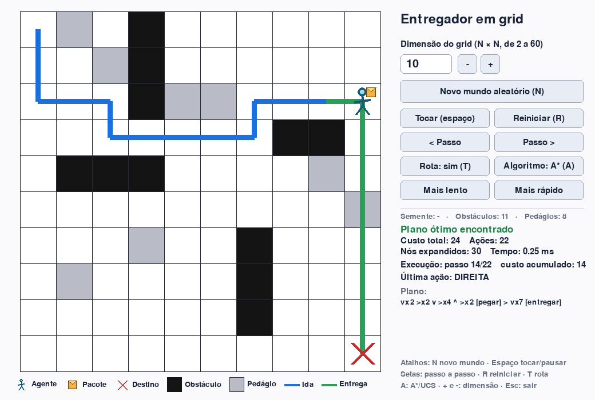

APS 04: implementação da questão da prova




## Como rodar

```bash
pip install -r requirements.txt     # só para a GUI e o PNG

python main.py                      # abre a interface gráfica
python main.py -n 20 -s 42          # com grid 20x20 e semente 42
```

Linha de comando:

```bash
python main.py --exemplo-prova                    # o mundo 10x10 da figura da prova
python main.py --cli -n 15 -s 7                   # mundo aleatório 15x15 (semente 7)
python main.py --cli -n 15 -s 7 --algoritmo ucs   # custo uniforme, para comparar
python main.py --arquivo examples/04_sem_solucao_manual_8x8.mundo.txt
python main.py --cli -n 20 -s 79 --png saida.png  # salva imagem com a rota
```

### Interface gráfica

| Controle | Função |
|---|---|
| Caixa de dimensão, `+` / `-` | define N (2 a 60); Enter ou **Novo mundo** gera um mundo aleatório com esse N |
| **Tocar / Pausar** (espaço) | anima o plano ótimo; velocidade em **Mais lento / Mais rápido** |
| **< Passo** / **Passo >** (setas) | avança ou volta uma ação |
| **Rota** (T) | mostra/oculta a rota (azul = indo ao pacote, verde = entregando) |
| **Algoritmo** (A) | alterna A\* e custo uniforme (compare "Nós expandidos") |

Quando o mundo sorteado **não tem solução**, a grade ganha uma borda vermelha e o painel mostra **NÃO EXISTE SOLUÇÃO** com o motivo.

### Formato de arquivo de mundo (`--arquivo`)

Texto, uma linha por linha do grid (precisa ser quadrado). Linhas iniciadas por `;` são comentários.

```
A  agente      P  pacote      X  destino
#  obstáculo   ~  pedágio     .  livre
```

(Letra minúscula `a`/`p`/`x` = aquela célula especial sobre um pedágio.)

## Estrutura do repositório

```
main.py                    ponto de entrada (GUI por padrão, --cli para terminal)
entregador/
  mundo.py                 regras do problema (simulador), geração aleatória, ASCII
  busca.py                 A* / custo uniforme, detecção de "sem solução", referência exaustiva
  interface.py             interface gráfica (pygame)
  desenho.py               desenho do grid e exportação de PNG
  cli.py                   relatório em texto
tests/                     42 testes (unittest)
docs/modelagem.md          modelagem, provas, complexidade, validação
examples/                  exemplos de execução (mundo de entrada, saída em texto, PNG)
scripts/                   benchmark.py e gerar_exemplos.py
```

## Testes

```bash
python -m unittest discover -s tests -v
```

Os testes da interface rodam sem monitor (driver `dummy` do SDL) e são ignorados se o pygame não estiver instalado.

## Exemplos de execução

Cada exemplo tem o mundo de entrada (`.mundo.txt`), a saída completa (`.saida.txt`) e uma imagem (`.png`) em [`examples/`](examples/):

| Exemplo | Resultado |
|---|---|
| `01_exemplo_da_prova_10x10` | custo ótimo **24**, 22 ações (o mundo da figura do enunciado) |
| `02_aleatorio_20x20_semente79` | custo ótimo **43**, 37 ações, 3 ações executadas em pedágio |
| `03_aleatorio_40x40_semente5` | custo ótimo **114**, 112 ações |
| `04_sem_solucao_manual_8x8` | **não existe solução** (pacote cercado por obstáculos) |
| `05_sem_solucao_aleatorio_12x12_semente10` | **não existe solução** (sorteado aleatoriamente) |

Trecho da saída do exemplo da prova:

```
RESULTADO: Plano ótimo encontrado (A*).
Custo total: 24 | Ações: 22 | Nós expandidos: 30 | Nós gerados: 54

Plano (→ direita, ← esquerda, ↑ cima, ↓ baixo; ×k = repetido k vezes):
↓×2 →×2 ↓ →×4 ↑ →×2 [pegar] → ↓×7 [entregar]

Rota sobre o mundo:
A~.#......
*.~#......
***#~~**P*
..*****##*
.###....~*
.........+
...~..#..*
.~....#..*
......#..*
.........X
```

(`*` = rota por célula livre, `+` = rota por pedágio. O custo 24 = 22 ações + 2 de sobretaxa do único pedágio em que uma ação é executada, a célula `+`.)

Para regerar todos os exemplos: `python scripts/gerar_exemplos.py`.

## Resumo da modelagem

- **Estado:** `(linha, coluna, carregando)` — 2·N² estados (justificativa em `docs/modelagem.md`, seção 4).
- **Custo:** 1 por ação; 3 se a ação é executada numa célula de pedágio.
- **Heurística:** `h = Manhattan(agente→pacote) + 1 + Manhattan(pacote→destino) + 1` antes de pegar; `Manhattan(agente→destino) + 1` carregando. Consistente ⇒ A\* ótimo.
- **Sem solução:** existe solução ⇔ o pacote é alcançável pelo agente **e** o destino é alcançável pelo pacote.
